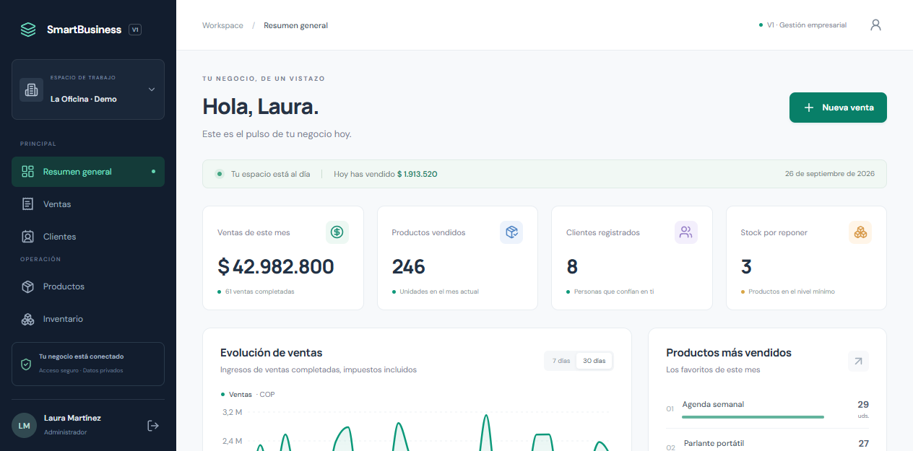

# SmartBusiness AI · V1

Sistema SaaS multiempresa para gestionar clientes, proveedores, productos, inventario y ventas. API REST con Laravel y PostgreSQL; interfaz React + TypeScript + Vite. Proyecto de portafolio con autorización, integridad de datos y pruebas reales.

> La V1 implementa gestión empresarial. El asistente IA, Tool Calling y RAG pertenecen al roadmap y todavía no están implementados.

## Vista del producto



## Funcionalidades

- Registro de empresa y administrador, login/logout con cookies Sanctum, perfil y recuperación de contraseña.
- Roles administrador, gerente y vendedor, con permisos por empresa.
- Clientes y compras; proveedores y productos asociados.
- Categorías y productos con SKU único por empresa, precios e impuestos configurables.
- Entradas, salidas y ajustes, historial y detección de stock bajo.
- Ventas con precios calculados por el servidor, transacciones, bloqueo de filas e idempotencia.
- Anulaciones con movimientos inversos y preservación del historial.
- Dashboard con ventas diarias/mensuales, tendencia, rankings y stock bajo.
- Interfaz adaptable a móvil, búsqueda, paginación y mensajes de error.
- Tests sobre PostgreSQL, incluyendo dos procesos vendiendo la última unidad.

## Tecnologías

Laravel 12, PHP 8.2+ (Docker: PHP 8.4), Sanctum 4, PostgreSQL 17, React 19, TypeScript 5, Vite 7, PHPUnit 11, Vitest, Pint, Docker Compose y GitHub Actions. Se conserva Laravel 12 para funcionar con XAMPP PHP 8.2; planifica su actualización antes del fin de soporte de seguridad en febrero de 2027.

## Estructura

```text
app/                   API: controllers, requests, resources, models, policies y services
database/              Migraciones, factories y seeders
frontend/              SPA React independiente
tests/                 Unit, Feature y prueba de concurrencia
scripts/               Arranque local para Windows
infra/                 Nginx, PostgreSQL y guía Azure
docs/                  Arquitectura, API, base de datos y mentoría
.github/workflows/     CI y despliegue Azure manual
```

Laravel se mantiene en la raíz porque la carpeta recibida ya contenía esa instalación.

## Arranque en esta máquina (Windows)

La entrega local incluye dependencias y un PostgreSQL portátil dentro de .local/ (no versionado). No se modificó php.ini ni se instaló un servicio Windows.

```powershell
cd C:\Users\lenin\Documents\Laravel\SmartBusiness_AI_V1
.\scripts\dev.ps1
```

Abre **http://localhost:5173**. API: http://localhost:8000/up.

Si PowerShell bloquea scripts, usa la política del proceso, sin cambiar la configuración global:

```powershell
powershell -ExecutionPolicy Bypass -File .\scripts\dev.ps1
```

Detener: `.\scripts\stop.ps1`. Para detener también PostgreSQL: `.\scripts\stop.ps1 -Database`. Los datos permanecen.

### Acceso de demostración

| Rol | Email |
| --- | --- |
| Administrador | demo@smartbusiness.test |
| Gerente | gerente@smartbusiness.test |
| Vendedor | vendedor@smartbusiness.test |

Contraseña local para estas tres cuentas: **SmartBusiness2026!**. La empresa está identificada como “La Oficina · Demo”; todos sus datos son ficticios. DemoSeeder se niega a ejecutarse en producción.

También puedes crear una empresa vacía desde “Crea tu empresa”.

## Instalación desde un clon limpio

Requisitos: PHP >= 8.2 con pdo_pgsql, mbstring, openssl, bcmath, dom y xml; Composer; Node 22.12+ o 24; PostgreSQL 17.

1. `composer install`
2. Copia `.env.example` a `.env`.
3. Crea las bases `smartbusiness` y `smartbusiness_test`; configura un usuario propietario de esas bases.
4. Configura DB_HOST, DB_PORT, DB_USERNAME y DB_PASSWORD.
5. `php artisan key:generate`
6. `php artisan migrate --seed`
7. Opcional, solo local: `php artisan db:seed --class=DemoSeeder`.
8. `npm --prefix frontend ci`.
9. En terminales independientes: `php artisan serve --host=127.0.0.1`, `npm --prefix frontend run dev` y `php artisan queue:work --tries=3`.

El frontend redirige /api y /sanctum hacia el backend durante desarrollo. Usa siempre localhost de forma consistente; no mezcles dominios entre la página y las cookies.

### Variables relevantes

| Variable | Uso |
| --- | --- |
| APP_KEY | Cifrado; generar una vez y conservar de forma segura |
| APP_ENV / APP_DEBUG | local/true para desarrollo; production/false al publicar |
| APP_URL / FRONTEND_URL | URL de API y frontend |
| DB_* | Credenciales y conexión PostgreSQL |
| DB_SSLMODE | prefer local; verify-full en cloud con certificados configurados |
| SANCTUM_STATEFUL_DOMAINS | Hosts y puertos de la SPA, sin esquema |
| SESSION_DRIVER | database |
| SESSION_SECURE_COOKIE | true con HTTPS |
| QUEUE_CONNECTION | database; no se necesita Redis en esta V1 |
| MAIL_MAILER | log local; configurar SMTP o proveedor antes de producción |

Localmente, los enlaces de recuperación se escriben en storage/logs/laravel.log. No se envían correos reales hasta configurar un proveedor.

## Testing

```powershell
.\scripts\php.ps1 vendor/bin/phpunit
php vendor/bin/pint --test
npm --prefix frontend test
npm --prefix frontend run build
```

En PHP con pdo_pgsql ya habilitado: `php artisan test`. En XAMPP se usa PHPUnit directamente porque el subproceso de artisan test no hereda la opción -d de PHP. PHPUnit fija **smartbusiness_test**, nunca la base de desarrollo. La prueba de concurrencia levanta dos procesos PHP y verifica que solo uno puede vender la última unidad.

Cobertura funcional: autenticación, CSRF, rate limit, permisos, aislamiento, claves foráneas, stock negativo, dinero, rollback, idempotencia, anulaciones, catálogo, zonas horarias y concurrencia. No equivale a una auditoría de seguridad ni a una prueba de carga.

## Docker

1. Crea .env y genera APP_KEY; define una contraseña de desarrollo para DB_PASSWORD.
2. `docker compose build`.
3. `docker compose up -d database`.
4. `docker compose run --rm api php artisan migrate --seed --force`.
5. Opcional local: `docker compose run --rm api php artisan db:seed --class=DemoSeeder`.
6. `docker compose up -d`.
7. Abre **http://localhost:8080**.

Servicios: Nginx sirve React y dirige la API a PHP-FPM; api ejecuta Laravel; worker procesa el listener de ventas; database persiste PostgreSQL en un volumen. La base no expone un puerto público. La imagen final excluye dependencias de desarrollo y secretos.

Los contenedores no se ejecutaron en la máquina de entrega porque Docker no está instalado. El workflow CI incluye la construcción de ambas imágenes.

## CI/CD y Git

CI valida Composer, formato PHP, tests PostgreSQL en PHP 8.2/8.4, tests/build React, auditorías de dependencias y build Docker. El workflow Azure es manual y requiere recursos previamente configurados. No se ha ejecutado en GitHub ni Azure desde esta entrega.

main contiene la instalación inicial; feat/smartbusiness-v1 contiene commits separados por área. No hay remoto ni Pull Request creados. Al publicar, configura tu remoto y abre un PR desde esta branch. No subas .env, .local/, vendor/ ni node_modules/.

## Documentación

- [Arquitectura y decisiones](docs/architecture.md)
- [Modelo de datos](docs/database.md)
- [Endpoints y ejemplos](docs/api.md)
- [Guía Azure y despliegue](infra/azure/README.md)
- [Roadmap y primera tarea de mentoría](docs/roadmap.md)

## Estado y límites

La aplicación funciona localmente. GitHub remoto, correo real, dominio, TLS y recursos Azure requieren tu configuración. No incluye pagos, factura fiscal, compras a proveedores, almacenes múltiples, roles personalizados, invitaciones de cuentas existentes ni IA. Cantidades enteras y una moneda base por empresa.

Antes de un uso empresarial real: revisa reglas fiscales y de redondeo del país, configura copias de seguridad con restauración probada, monitoreo, correo, acceso de red y versiones soportadas de PHP/Laravel. Las tasas del catálogo demo son ilustrativas.
