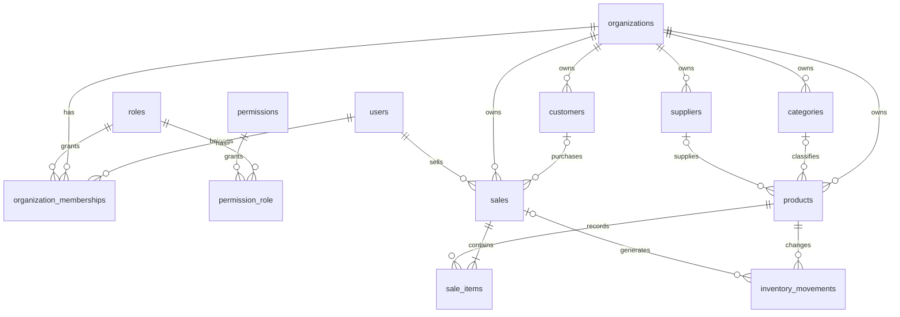

# Modelo de datos

## Relaciones

## Reglas

| Tabla | Regla o índice |
| --- | --- |
| users | Email único; password con hash; nunca se devuelve el hash |
| organization_memberships | Un usuario/empresa único; rol por membresía |
| categories | Nombre único dentro de una empresa, incluso archivado |
| products | SKU y código únicos por empresa; precios NUMERIC(12,2); stock entero |
| sales | Número y request_key únicos por empresa; importes NUMERIC(16,2); vendedor debe ser miembro |
| sale_items | Un producto por venta; precio y descripción históricos |
| inventory_movements | Delta distinto de cero; saldo no negativo; referencia opcional a venta |

Todos los IDs son BIGINT. Las tablas hijas de negocio guardan organization_id. La duplicación del tenant en sale_items permite una FK compuesta que valida simultáneamente la venta y el producto.

Un cliente o proveedor archivado conserva sus referencias. Las ventas completadas y los movimientos no se eliminan por HTTP. Un producto con stock no puede archivarse; primero se registra un ajuste justificado.

No hay tablas de historial de compras ni dashboard: son consultas. Sessions, password_reset_tokens, cache, jobs y failed_jobs son infraestructura Laravel. No se instala la tabla de tokens personales porque esta V1 utiliza Sanctum exclusivamente en modo SPA; no ofrece emisión de API tokens.

La migración usa CHECK y claves foráneas reales de PostgreSQL. No se promete compatibilidad con SQLite.
